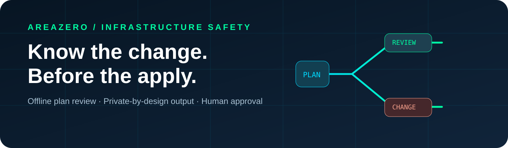
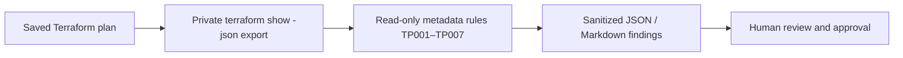

<p align="center"></p>
<p align="center"></p>

# Terraform Plan Impact Audit

**Understand the blast-radius *questions* before `terraform apply` — without displaying plan values.** A read-only Python Agent Skill that analyzes Terraform's saved-plan JSON for deletion, replacement order, external drift, failed checks and output removals. It emits sanitized resource addresses, deterministic rule IDs and a human review checklist rather than dumping secret-bearing plan data.

[](https://github.com/Kanompung1988/terraform-plan-impact-audit/actions/workflows/ci.yml) · [Agent Skills](https://agentskills.io/specification) · [Rules](references/RULES.md) · [Upstream sources](references/SOURCES.md) · [MIT license](LICENSE)

## The risk it addresses

A "green" Terraform syntax check is not a risk assessment. The same plan may replace a database destroy-first, delete a bucket, remove an output consumed by another pipeline, or contain out-of-band drift. An AI coding agent should present the **specific decision points** for human approval without pasting a plan that may contain plaintext credentials.



## Quickstart

```bash
git clone https://github.com/Kanompung1988/terraform-plan-impact-audit.git
cd terraform-plan-impact-audit
python scripts/audit.py examples/safe-plan.json --format json --fail-on high
python scripts/audit.py examples/review-plan.json --format markdown --fail-on none
# Actual sensitive workflow: keep this file private, never commit it.
terraform plan -out=tfplan
terraform show -json tfplan > tfplan.json
python scripts/audit.py tfplan.json --fail-on high
```

**Exit codes:** `0` = no findings meeting selected threshold, `2` = review threshold reached, `1` = invalid/unsupported input. `--fail-on none` is a report-only mode and should not gate a release. The tool does not execute Terraform, contact your provider or modify configuration.

### Synthetic fixture outcome

| Fixture | Expected | Sample rule summary |
|---|---|---|
| `examples/safe-plan.json` | Exit 0, no findings | One ordinary update |
| `examples/review-plan.json` | Exit 2 at high threshold | TP001 delete, TP002 destroy-first replacement, TP004 drift, TP005 failed check, TP006 output deleted, TP007 unknown output |

Fixtures contain the literal harmless marker `DUMMY-DO-NOT-PRINT`; tests verify the scanner never emits it. Even when values are excluded, **resource addresses may still reveal names**; the scanner masks bracketed `for_each` keys and limits labels to 160 characters.

## Install for coding agents

| Runtime | Local project install |
|---|---|
| Claude Code | `mkdir -p .claude/skills && git clone --depth 1 https://github.com/Kanompung1988/terraform-plan-impact-audit.git .claude/skills/terraform-plan-impact-audit` |
| Codex | `mkdir -p .agents/skills && git clone --depth 1 https://github.com/Kanompung1988/terraform-plan-impact-audit.git .agents/skills/terraform-plan-impact-audit` |

**Suggested agent prompt:** “Review my saved Terraform plan using terraform-plan-impact-audit. Don't print resource values or run apply. Show deletes, replacements, drift, failed checks, output removals, exit code and follow-up approvals.”

## Quality, privacy and limitations

- `SKILL.md`: trigger, non-trigger, safe workflow; `scripts/audit.py`: dependency-free JSON analyzer; `tests/test_audit.py`: 22 synthetic unit tests; `examples/`: safe/review plans; `references/`: rules and upstream semantics; `.github/workflows/ci.yml`: Python 3.10/3.12 plus fixtures.
- Validate with `python -m unittest discover -s tests -v`. CI badges indicate GitHub's latest workflow status, not independent external security review.
- **Important:** `terraform show -json` can contain plaintext sensitive values. NEVER publish the exported JSON. Do not treat redacted output as declassification or assume real-world availability from static plan actions.
- False positives and negatives are possible: applies can be interrupted, state can drift between inspection and execution, and provider semantics are richer than this rule set.

## Credits and contributions

Original implementation and synthetic fixtures © 2026 AREAZERO Skill Lab, MIT software license. The included official owner-supplied Area Zero logo is **not** granted under MIT and may not be reused to imply endorsement. See [CONTRIBUTING](CONTRIBUTING.md) and [SECURITY](SECURITY.md).
